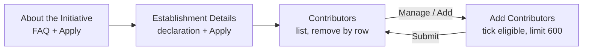
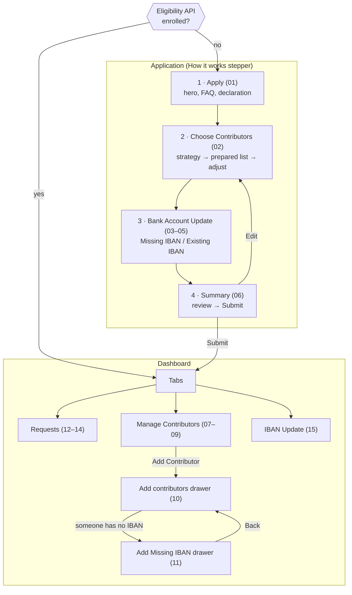

# Daam Initiative — migration to the new design

This folder implements the Daam Initiative (Aviation Sector) feature. It was first built from the **old design**
(`ux/*.html` in the repo root) and has now been rebuilt for the **new design** (`daam-initiative-screens/01–15.html`).
This document explains what changed, how the new flow works, and how to plug in the real API.

---

## 1. At a glance

| | Old design | New design |
|---|---|---|
| Screens | 4 | 15 (4-step application + dashboard with 3 tabs + 2 drawers) |
| Entry point | Always "About the Initiative" | **Eligibility API** decides: application or dashboard |
| Choosing contributors | Tick contributors manually (eligible / not eligible) | Pick a **strategy** that pre-fills the list, then adjust |
| IBANs | Not handled | Dedicated step + drawer to add / correct IBANs |
| After applying | A list of added contributors, remove by row | **Dashboard**: Requests, Manage Contributors, IBAN Update |
| Data | Hard-coded in the SC | Mock **API service** + mock **JSON** (swap for the real API) |
| Styling | Default encapsulation, styles per component | Non-encapsulated, scoped under each host tag, shared styles in the SC |

---

## 2. Old design (for reference — removed)



Removed components: `about-initiative-dc`, `establishment-details-dc`, `contributors-dc`, the old `add-contributors-dc`
(the name is reused for the new drawer), `initiative-sc-tables.scss` (replaced) and the old `Contributor.eligible /
ineligibilityReason` fields.

---

## 3. New design — the flow



### Step by step

| Screen (design file) | Component | What happens |
|---|---|---|
| — | `initiative-sc` | Calls **eligibility** first. Not enrolled → loads FAQs + eligible contributors → Apply. Enrolled → loads requests, members, IBAN updates → Dashboard. Shows "Loading…" until the first screen's data is in; on failure, an error with **Try again**. |
| 01 Apply | `apply-dc` | Eligibility hero (establishment name / number), stepper, FAQ accordion, declaration checkbox. **Apply** is disabled until the declaration is ticked. |
| 02 Choose Contributors | `choose-contributors-dc` | Four strategies: Highest Wage, Lowest Wage, Joining Date, Customize Selection. Picking one asks the API for the **prepared list** (up to the limit; Customize = empty). Then tick / untick in the **Selected / Not Selected** tabs. The limit is enforced (extra checkboxes disable). Counter: "*n* of *max* selected · *k* without IBAN". Next is disabled with nobody selected. |
| 03–05 Bank Account Update | `bank-account-dc` | **Missing IBAN** tab: type the IBAN straight in. **Existing IBAN** tab: rows are locked; pencil → edit, ✓ save, ✕ cancel (one row at a time; Next disabled while editing). Opens on Existing IBAN when nobody is missing one. Searching or paging cancels an open edit. Leaving the field asks the API for the bank name. |
| 06 Summary | `request-summary-dc` | Establishment, terms accepted, strategy, total estimated monthly benefit, count vs limit, "What happens next?". Edit → step 2, Back → step 3, **Submit** → API → dashboard. |
| 12–14 Requests | `requests-dc` | One card per request (transaction ID, date, count, status: Under Review / Approved / Rejected). Expand to see its contributors with **Added / Removed**; search across requests and inside a card. |
| 07–09 Manage Contributors | `manage-contributors-dc` | Contributors in the initiative. Tick rows → selection bar → **Remove from Initiative** (creates a removal request). **Add Contributor** is disabled with a tooltip when the limit is reached. **Download List** exports a CSV (stand-in until the API has an export). |
| 10 Add contributors | `add-contributors-dc` (drawer) | Eligible contributors not yet in the initiative; select up to the places left ("*n* selected / *r* remains"). |
| 11 Add Missing IBAN | `add-missing-iban-dc` (drawer) | Shown only if someone being added has no IBAN. Submit needs an IBAN for **every** row (even ones hidden by the search). **Back** returns to the list and keeps what was typed. |
| 15 IBAN Update | `iban-update-dc` | IBANs added or changed, waiting for validation ("Under Review"). |

Shared pieces: `how-it-works-dc` (the stepper), `pagination-dc` (1 2 3 … 8 9 10), `icon-dc` (all design icons, exported
from Figma, in one place).

### Behaviour worth knowing

- **Only the SC talks to the API.** Every dc component is presentational: data in through `@Input`, actions out through `@Output`.
- **IBANs are shown exactly as the API returns them** — `maskedIban` in lists, `iban` in the edit field, `bankName` beside it.
  There is no client-side IBAN validation, formatting or masking; a typed IBAN is sent as typed and the API validates it.
  The ✓ seal shows only on an IBAN that came from the API and hasn't been edited.
- **Requests can't be sent twice**: Submit / Add / Remove are disabled while a request is in flight.
- **Latest strategy wins**: switching strategies quickly ignores a slower, older response.
- New screens open **scrolled to the top**; drawers take **keyboard focus**, close on **Esc** or a backdrop click.

---

## 4. Data and API

All calls live in **`components/initiative-api.service.ts`**, which is currently a **mock**: reads come from
`components/mock/*.json`, writes are kept in memory. To go live, replace each method body with the HttpClient call
(each is marked `TODO`) — the signatures stay the same, so no component changes.

| Method | Used for | Mock source |
|---|---|---|
| `getEligibility()` | First call; establishment, `maxContributors`, `enrolled` | `mock/eligibility.json` |
| `getFaqs()` | Apply screen | `mock/faqs.json` |
| `getEligibleContributors()` | Step 2 list, add drawer | `mock/eligible-contributors.json` |
| `getStrategySelection(strategy)` | Step 2 prepared list | sorted from the contributors |
| `getBankName(iban)` | Bank name for a typed IBAN | `mock/banks.json` |
| `submitApplication(selection)` | Summary → Submit | in memory |
| `addContributors(contributors)` | Add drawer / Missing IBAN drawer | in memory |
| `removeContributors(members)` | Remove from Initiative | in memory |
| `getRequests()` · `getMembers()` · `getIbanUpdates()` | Dashboard tabs | in memory, seeded from `mock/dashboard-*.json` when enrolled |

After every write the SC reloads the dashboard lists from the API.

**Try both paths:** set `"enrolled": true` in `mock/eligibility.json` to start on the dashboard with the sample history
(4 requests, 10 of 14 places used, 1 IBAN update); `false` starts the application. The mock also adds a 300 ms delay
(`latencyMs`) so loading states are visible.

### Models (`components/initiative.models.ts`)

| Model | Change |
|---|---|
| `Eligibility` | **New** — `establishment`, `maxContributors`, `enrolled` |
| `Establishment` | Unchanged (`name`, `registrationNumber`) |
| `Contributor` | `eligible` / `ineligibilityReason` removed; `benefitAmount` now required; **new** `iban`, `maskedIban`, `bankName` |
| `SelectionStrategy`, `StrategyOption`, `STRATEGY_OPTIONS`, `ContributorSelection` | **New** — step 2 |
| `InitiativeMember` | **New** — contributor + `requestId`, `benefitStart`, `benefitEnd` |
| `InitiativeRequest`, `RequestLine`, `RequestStatus` | **New** — Requests tab |
| `IbanUpdate` | **New** — IBAN Update tab |
| `Faq` | Unchanged (now loaded from the API) |

The strategy cards and the stepper's 4 steps are UI text in code, not API data.

---

## 5. Styling

- Design tokens (colours, font) are CSS variables on `app-initiative-sc`.
- The SC is **not encapsulated** and its styles are nested under `app-initiative-sc`, so they reach the dc components
  without leaking into the host app. They live in **`components/initiative-sc/styles/`**:
  `initiative-sc.component.scss` (tokens, layout, steps, tabs, toolbar, buttons), `initiative-sc-tables.scss`,
  `initiative-sc-iban.scss` (IBAN rows / fields), `initiative-sc-drawer.scss`. They're split to stay within the
  8 kB per-stylesheet production budget.
- Each dc component is also non-encapsulated with its styles nested under its own host tag (e.g. `app-apply-dc { … }`),
  so it overrides the shared rules and can style the icons inside `app-icon-dc`.
- The designs load the **IBM Plex Sans Arabic** web font; this folder doesn't (the host app decides fonts), so it falls
  back to the system font unless the host adds it.

---

## 6. Folder structure

```
initiative/
├── MIGRATION.md                      ← this file
├── initiative.module.ts              ← lazy-loaded feature module
├── initiative-routing.module.ts
├── initiative-dc.component.*         ← route shell (<router-outlet>)
└── components/                       ← reusable on its own (see §7)
    ├── initiative-components.module.ts   declares everything, provides the API service
    ├── index.ts                          public exports
    ├── initiative.models.ts
    ├── initiative-api.service.ts         the (mock) API
    ├── mock/                             JSON the mock serves
    ├── initiative-sc/                    smart component + styles/
    ├── apply-dc/  choose-contributors-dc/  bank-account-dc/  request-summary-dc/
    ├── requests-dc/  manage-contributors-dc/  iban-update-dc/
    ├── add-contributors-dc/  add-missing-iban-dc/
    └── how-it-works-dc/  pagination-dc/  icon-dc/
```

---

## 7. Is the folder still independent? Yes

Checked by scanning every import:

- **No import leaves the folder** — all relative imports resolve inside `features/initiative`.
- **Packages used:** `@angular/core`, `@angular/common`, `@angular/forms`, `@angular/router`, `@angular/core/rxjs-interop`, `rxjs`.
- **No assets:** icons are inline SVG, the checkbox images are data URIs, mock data is bundled JSON.
- **The only link from outside** is the lazy route in the host app:
  ```ts
  { path: 'initiative', loadChildren: () => import('./features/initiative/initiative.module').then((m) => m.InitiativeModule) }
  ```
- To reuse just the components in another app: import `InitiativeComponentsModule` and add `<app-initiative-sc></app-initiative-sc>`.

**New requirements compared to the old version** — check these in a host app:

| Requirement | Why |
|---|---|
| Angular **16+** | `takeUntilDestroyed` from `@angular/core/rxjs-interop` |
| TypeScript **`resolveJsonModule`** enabled | The mock service imports `mock/*.json`. This app gets it from `"module": "preserve"`; other setups may need `"resolveJsonModule": true` in `tsconfig.json`. Goes away once the mock is replaced by HttpClient calls. |
| HttpClient (later) | Only when the real API replaces the mock — provide it in the host app (`provideHttpClient()`). |
| Modern browser | CSS `:has()` (from the design) and `structuredClone` (mock only). |

---

## 8. Open items

- **Filter** buttons have no panel yet (not in the design).
- **Download List** builds a CSV in the browser — replace with the API's export when there is one.
- **Statuses:** members only show "Active" and IBAN updates only "Under Review" — the only values in the design.
- The page behind an open drawer can still scroll.
- In Manage Contributors, rows hidden by a search stay selected (the count shows the total).
- The same IBAN can be entered for two contributors — left to the API to reject.
- There are **no unit tests** (spec files were removed); `ng test` reports "No tests found".
